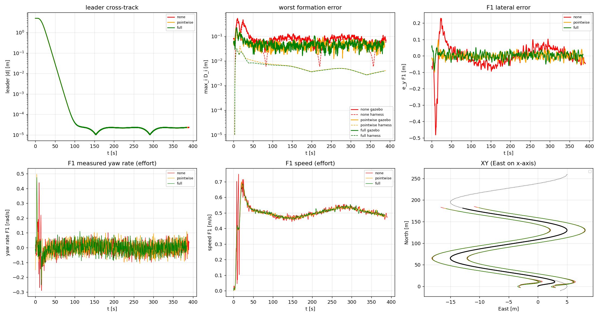
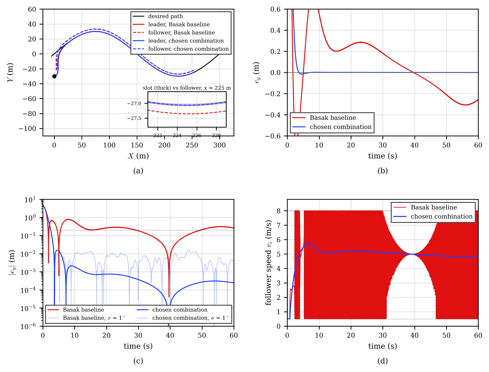
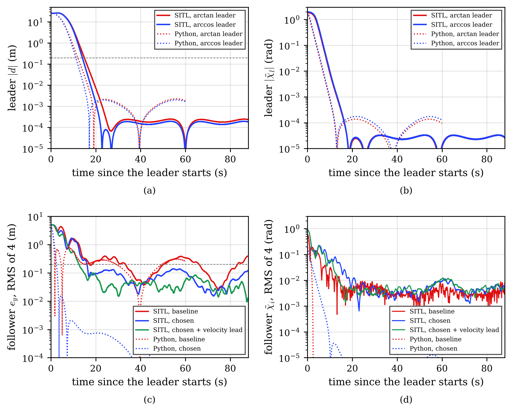

# swarm_formation

Four PX4 quadrotors flying in formation behind a virtual leader, in Gazebo, with ROS 2.

This is my implementation of the guidance law from Basak and Ghosh, *Virtual Leader-based Multi-UAV Formation Path Following Guidance Using Vector Field* (ICC 2025, [doi:10.1109/ICC69100.2025.11372370](https://doi.org/10.1109/ICC69100.2025.11372370)). A virtual leader flies along a path at constant speed, and each drone holds a fixed slot around it, one per quadrant.

I also added one thing the paper doesn't have, which I call the carousel correction (Δ). It's explained below, and it halves the formation error on curved paths.

**This repo is also my BTP1 (B.Tech Project, part 1) work.** The offline study comparing Basak's controller against my chosen combination, and the PX4/Gazebo runs that back it up, are in [`btp1/`](btp1/). The [BTP1 section](#btp1-btech-project-part-1) below summarises the results.



## Quick start

Tested on Ubuntu 24.04 with ROS 2 Jazzy, Gazebo Harmonic, PX4 v1.17.0 (`gz_x500`) and Micro-XRCE-DDS-Agent v2.4.3. You also need `px4_msgs` in the same workspace.

```bash
cd ~/ros2_ws/src
git clone -b jazzy-harmonic https://github.com/SPK2005/swarm_formation.git
cd ~/ros2_ws && colcon build --symlink-install && source install/setup.bash
./src/swarm_formation/scripts/start_swarm.sh
```

The script starts the DDS agent, Gazebo and 4 PX4 instances, then launches the ROS nodes. It expects PX4 in `~/tools/PX4-Autopilot`. If yours is somewhere else, set `PX4_DIR`. Ctrl-C shuts everything down.

BTP1 Chapter 7 runs (match the Python study in [`btp1/`](btp1/): 5 m/s, y = 30 sin(2πx/300), r_min = 20 m gains, leader 25.5 m off the path, drones 5 m off their slots):

```bash
start_swarm.sh --btp baseline    --tag btp_baseline --no-rviz   # Basak: guard speed law, no Δ, arctan, sign-power
start_swarm.sh --btp chosen      --tag btp_chosen   --no-rviz   # ε-fix, full Δ, arccos field, saturation, arccos leader
start_swarm.sh --btp chosen_lead --tag btp_lead     --no-rviz   # chosen + velocity lead for PX4's 0.385 s lag
```

`--btp` loads `config/formation_btp.yaml` and `config/params_btp_<name>.yaml`; any params YAML can be passed with `--params FILE`. The path is `--leader sine`. Without these flags every node keeps its old defaults.

Some other ways to run it:

```bash
start_swarm.sh --leader circle --no-rviz       # other paths: sinusoid, figure8, straight_line
start_swarm.sh --path-offset 5                 # leader starts 5 m off the path and flies onto it
start_swarm.sh --path-offset 10,10             # offset North 10, East 10
start_swarm.sh --delta off                     # paper's laws only, no carousel correction
start_swarm.sh --delta on --delta-dot off      # Δ without its feedforward
start_swarm.sh --n 1 --leader straight_line    # one drone
```

Logs go to `~/sim_logs/sitl/runs/<timestamp>/`: one CSV, a `run_config.txt` with the flags used, and the process logs. After a run, `scripts/index_sim_logs.sh` refreshes `~/sim_logs/INDEX.md` (one row per run) and records checksums in `MANIFEST.sha256`; `scripts/index_sim_logs.sh --verify` checks nothing has been lost or changed.

```
~/sim_logs/
  INDEX.md, MANIFEST.sha256
  sitl/runs/<timestamp>/   start_swarm.sh runs
  sitl/step8/<tag>/        Step 8 runs (--log-dir ~/sim_logs/sitl/step8/<tag>)
  sitl/standalone/         formation_logger run on its own
  numpy/                   older numpy plots (current ones live in study/figures, in git)
```

If Gazebo hangs with `Network is unreachable`, run with `GZ_IP=127.0.0.1`.

## Start poses and formation

Edit [config/formation.yaml](config/formation.yaml): the leader's start point and heading, and each drone's slot, spawn point and heading. Slots and spawns (`spawn_rel`) are metres ahead/right of the leader and headings (`heading_rel_deg`) are relative to the leader's, so moving or turning the leader carries the whole formation with it; `spawn_rel` = `slot` spawns a drone on its slot. Absolute `spawn: [north, east]` / `heading_deg` are also accepted. Each drone hovers at its spawn after takeoff until the leader starts moving, so all followers start together with the leader. Configs whose spawns are under 1.5 m apart, or whose straight spawn-to-slot routes cross or pass within 1.5 m, are refused before launch: all drones fly to their slots at the same time, and nothing else keeps them apart. The path always starts at the origin heading North; a leader that starts anywhere else flies onto it first. `start_swarm.sh` and all four nodes read this one file, and each run saves the copy it used as `formation.yaml` in its log folder. Use `--config FILE` to keep several setups side by side.

## How it works

There are four nodes:

- `path_leader` is the virtual leader. It works with any of the four paths. With no offset it sits exactly on the path. With an offset it starts away from the path and converges onto it using the paper's vector field (Eq. 5 and 6). It publishes pose, turn rate and turn acceleration, all computed analytically.
- `follower_controller` runs all four drones at 50 Hz. It computes heading with Eq. 14 and 15 and speed with Eq. 21, then sends yaw-rate and velocity setpoints to PX4.
- `formation_logger` writes the CSV.
- `swarm_visualizer` draws the formation in RViz.

The leader doesn't move until every drone is in OFFBOARD mode. The follower publishes `/formation_engaged` when that happens, and the leader then waits 3 s and ramps up to speed over 6 s.

### The carousel correction

When the leader turns, each slot around it moves a little sideways, like a seat on a carousel. The paper's follower always points along the leader's heading, so on a curve it settles with a small steady sideways error, `e_y = -tan(Δ)/k_y`. The fix is to steer to the slot's own heading instead:

```
Δ = atan2(ω·g_x, v_leader − ω·g_y)
```

Here ω is the leader's turn rate and `(g_x, g_y)` is the slot offset. Its derivative Δ̇ is fed forward in Eq. 15.

## Results

These runs use the sinusoid path, with the leader starting 5 m off it. Each run is about 380 s of flight, one run per mode. The full write-up is in [study/results_step8/STEP8_RESULTS.md](study/results_step8/STEP8_RESULTS.md).

| | paper laws | + Δ | + Δ and Δ̇ |
|---|---|---|---|
| steady formation error (RMS) | 6.1 cm | 3.2 cm | 3.3 cm |
| peak error at start-up | 55 cm | 20 cm | 23 cm |
| RMS acceleration | 0.073 m/s² | 0.020 m/s² | 0.020 m/s² |
| closest two drones got (6 m nominal) | 5.46 m | 5.89 m | 5.87 m |

What the numbers show:

- The leader reaches the path (within 10 cm) in 39 s, which matches the offline simulation.
- Δ halves the steady error, and the drones also accelerate less with it on.
- About 3 cm is as good as it gets in Gazebo, because PX4 can't track the velocity commands any better. In a perfect-plant simulation the same controller reaches 3 mm.
- Δ̇ makes no measurable difference in Gazebo.
- Every drone stayed in its own quadrant for the whole run.

## BTP1 (B.Tech Project, part 1)

My BTP1 asks which parts of Basak and Ghosh's guidance law to keep and which to change. The study starts from their controller and changes one factor at a time, offline in Python, then checks the final combination in PX4/Gazebo SITL. Everything is in [`btp1/`](btp1/) ([how to run it](btp1/README.md)).

Setup for all runs: leader at 5 m/s on y = 30 sin(2πx/300), four drones at slots (±3, ±3) m, r_min = 20 m gains.

| Phase | Factor | Folder |
|---|---|---|
| 1 | leader vector field: arctan vs arccos | [btp1/phase1](btp1/phase1) |
| 2 | follower speed law: guard (Eq. 21) vs ε-fix | [btp1/phase2](btp1/phase2) |
| 3 | heading correction: none / pointwise Δ / full Δ | [btp1/phase3](btp1/phase3) |
| 4 | follower field shape: arctan vs arccos, r_min sweep | [btp1/phase4](btp1/phase4) |
| 5 | reaching law: sign-power vs saturation, gains, heading noise | [btp1/phase5](btp1/phase5) |
| final | Basak baseline vs chosen combination | [btp1/final](btp1/final) |
| SITL | the same comparison on four PX4 x500s | [btp1/sitl](btp1/sitl) |

**Baseline** is Basak's follower (no Δ, arctan field, sign-power reaching law, guard speed law) with the arctan leader. **Chosen** is full Δ, arccos follower field, saturation reaching law, ε-fix speed law and the arccos leader.

Offline (Python, perfect plant, [final_table.md](btp1/final/final_table.md)):

| | baseline | chosen |
|---|---|---|
| steady RMS lateral error, nominal | 280 mm | 0.29 mm |
| follower settling (within 0.2 m) | never | 2.5 s |
| time on a speed limit | 33 s | 0.8 s |
| RMS lateral error with 1° heading noise | 282 mm | 3.1 mm |
| follower effort | 15.4 | 10.3 |

SITL (PX4 v1.17 + Gazebo Harmonic, [sitl_table.md](btp1/sitl/sitl_table.md), [findings](btp1/sitl/sitl_findings.md)):

| | baseline | chosen | chosen + velocity lead |
|---|---|---|---|
| carousel part of e_y (RMS) | 0.185 m | 0.022 m | 0.019 m |
| RMS e_y, worst drone | 0.30 m | 0.09 m | 0.047 m |
| mean formation error D | 0.247 m | 0.087 m | 0.048 m |
| all four drones settle | no | yes, 13–16 s | yes, 11–13 s |

What came out of it:

- The carousel effect predicted offline shows up in SITL almost exactly (correlation 0.996 with the Python baseline), and full Δ removes nearly all of it.
- PX4's velocity loop makes each drone's course trail its yaw by about 0.385 s, which adds a lateral bias common to all drones. Steering the velocity setpoint ahead by τ·χ̇ (`chosen_lead`) cancels most of it.
- Feeding back the measured course instead of yaw puts that lag inside the loop: the formation oscillated at ±4 m and the run was stopped at 28 s.
- The remaining ~4 cm in SITL is PX4 tracking, not the guidance law; offline the same law reaches 0.3 mm.





## Parameters

Leader defaults:

| Parameter | Default |
|---|---|
| speed | 0.5 m/s |
| sinusoid amplitude / wavelength | 10 m / 130 m |
| circle radius | 20 m |
| figure-8 length × width | 60 × 20 m |
| VF gains (K, β, ε, ω_max) | 0.3, 0.08, 0.3, 0.08 rad/s |

Follower values:

| Parameter | Value |
|---|---|
| k_y, k_D | 1.2, 0.4 |
| α, η, n/m | 1.65, π/4, 3/5 |
| speed limits | −0.3 to 1.2 m/s, max 1.5 m/s² |
| slots | (±3, ±3) m |

The paper's gains (k_y = k_D = 0.02, β = π/4) are tuned for 15 m/s and errors of tens of metres. At 0.5 m/s they're either far too slow or they saturate the followers.

Keep the path's tightest turn much wider than the formation, or Eq. 21 blows up. The default sinusoid's tightest turn is about 43 m, against a 4.2 m formation radius.

## Repo layout

```
scripts/start_swarm.sh        starts everything
scripts/index_sim_logs.sh     indexes and checksums ~/sim_logs
config/formation.yaml         leader start pose, follower spawns and slots
launch/swarm.launch.py        the ROS nodes
swarm_formation/              path_leader, follower_controller, formation_logger, swarm_visualizer
study/step1..7_*.py           offline numpy notebooks, building the controller up step by step
study/step8_ros_harness.py    the ROS controller in pure Python, with a perfect plant
study/step8_evaluate.py       metrics and plots from Gazebo CSVs
study/analyze_formation_csv.m MATLAB plots for one run (works in MATLAB Online)
study/results_step8/          Step 8 report and figures
btp1/                         BTP1 study: phase 1-5 + final Python runs, SITL logs and analysis
config/*_btp*.yaml            BTP1 SITL presets (start_swarm.sh --btp NAME)
data/                         CSVs referenced in the reports
```

To analyse a run in MATLAB, upload the CSV and its `run_config.txt` to the same folder, then run `analyze_formation_csv('formation_xxx.csv')`.

## Things I learned the hard way

- PX4 multi-vehicle odometry is relative to each drone's spawn point, not the world. Every node has to add the spawn offset back.
- NED to ENU is `(y, x, -z)`. Get it wrong and everything looks almost right.
- Don't finite-difference the leader's turn rate. The first sample gives the followers a heading kick.
- Command yaw rate, not yaw angle. A 10 Hz yaw-angle setpoint through PX4's ~0.3 s lag made a 0.78 Hz wobble. Switching to 50 Hz yaw rate cut it by more than half.
- Without the start gate, drones that armed late sat in the way of the others. One pair came within 0.42 m.
- PX4 v1.17 renamed some topics (`vehicle_local_position_v1`), which made my launch script wait forever.
- Start PX4 with `-d`, or its shell writes hundreds of MB of logs a minute.

## Limitations and next steps

- Collision avoidance relies on each drone staying in its own quadrant. That only holds if they all start together.
- There's one run per mode so far, so small differences between modes are within the noise.
- Only tested with 4 drones. I still need repeat runs, and the figure-8 and circle paths with the start gate.

The original Humble / Gazebo Classic version is on `main`.

## Citation

```bibtex
@inproceedings{basak2025virtual,
  title     = {Virtual Leader-based Multi-UAV Formation Path Following Guidance Using Vector Field},
  author    = {Basak, Subham and Ghosh, Satadal},
  booktitle = {2025 Eleventh Indian Control Conference (ICC)},
  year      = {2025},
  address   = {Bengaluru, India},
  doi       = {10.1109/ICC69100.2025.11372370}
}
```
