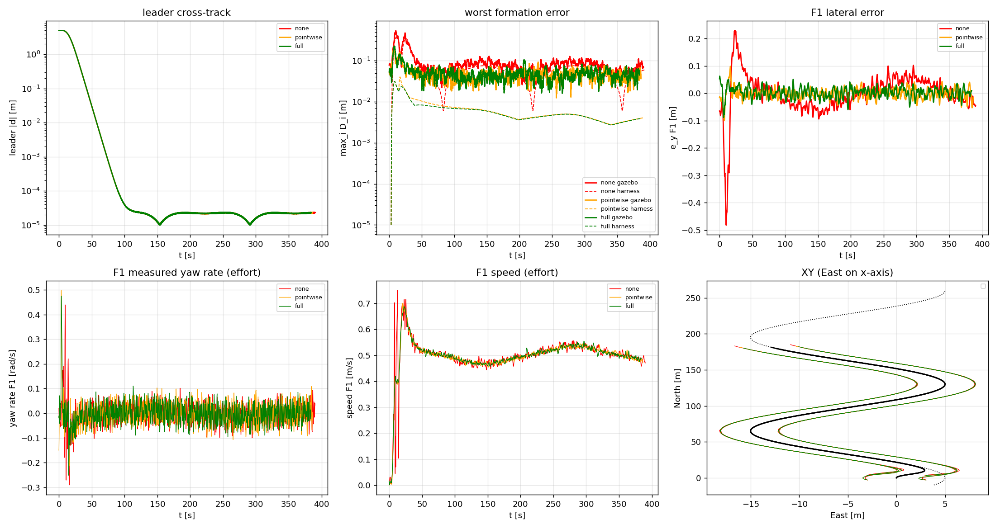
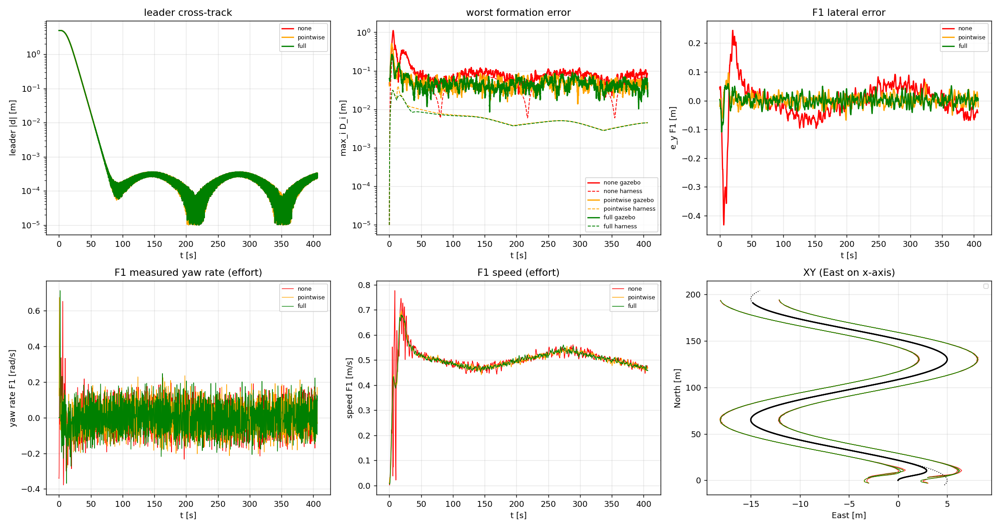
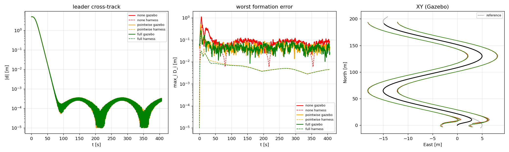

# Step 8 — VF leader in ROS/Gazebo: controller evaluation

**Revised 2026-10-05.** The original evaluation (2026-10-02) is kept below as a
historical section (§H). Its steady-state, leader and effort results stand,
but its **start-up (transient) results were confounded by a start-up race**:
the leader started on a fixed 20 s timer while some drones were still
climbing, so in every original run at least one follower joined the
formation late (§2). The v2 runs below repeat the three modes with that race
removed, on the current follower.

Three follower modes flown in PX4 SITL behind the vector-field virtual leader,
which starts 5 m off the sinusoid and converges onto it. One run per mode
(no repeats, so mode differences smaller than run-to-run noise cannot be
resolved).

---

## 1. v2 evaluation (2026-10-05)

### 1.1 What changed since the original runs

| Area | Original runs (vf_*) | v2 runs |
|---|---|---|
| Start | Leader moves 20 s after its node starts, regardless of the followers | **Start gate:** follower publishes latched `/formation_engaged` once drones 1..n are all in OFFBOARD; leader holds at the origin until then, waits `engage_delay` = 3 s, then ramps. 60 s fallback (`engage_timeout`) releases it anyway with a warning. Exact and VF mode. |
| Follower loop | 10 Hz, yaw-**angle** setpoint χ_c = χ + rate/α | **50 Hz, yaw-rate** setpoint (`yawspeed`, yaw = NaN; PX4 feeds it forward) |
| e_y rate in Eq. 15 | finite difference of e_y | exact kinematic derivative from odometry velocity |
| Leader | `vf_leader` (Euler step) | `path_leader` VF mode (exact arc step); same Eq. 5/6 law and gains, output identical to ≤ 4e-10 apart from the step |
| Logger | positions 4 decimals; second CSV from `plotter` | 6 decimals; one CSV |

Follower gains and laws (Eq. 14/15/21, Δ, Δ̇) are unchanged. No boundary layer
on the finite-time term.

### 1.2 Runs and validity

`./scripts/start_swarm.sh --leader sinusoid --path-offset 5 <mode flags> --tag <tag> --no-rviz`
under `timeout -s INT 480`, `GZ_IP=127.0.0.1`, logs in `~/sim_logs/sitl/step8/<tag>/`.

| tag | mode flags | attempts | flight after leader start | max D_i after 30 s | last drone engaged |
|---|---|---|---|---|---|
| v2_none | `--delta off` | 1, valid | 387 s | 0.188 m | 3.0 s before leader start |
| v2_pw | `--delta on --delta-dot off` | 1, valid | 383 s | 0.093 m | 3.0 s before leader start |
| v2_full | `--delta on` | 1, valid | 381 s | 0.106 m | 3.0 s before leader start |

Validity (all passed): exactly one CSV; 4× `OFFBOARD ENABLED`; `[vf] … d0=-5.00 m,
chi_tilde0=-0.983 rad`; follower log `control_rate=50 Hz yaw_cmd=rate`; one
`FORMATION ENGAGED` and the leader released by it (no fallback); every drone
engaged before the leader started; ≥ 180 s of flight; no D_i > 10 m after 30 s;
no NaN; `run_config.txt` flags as intended.

### 1.3 Metrics

`study/step8_evaluate.py … --t0 engaged` (time zero = `/formation_engaged`;
the leader starts 3.0 s later; "transient" = first 60 s after engagement;
leader convergence is timed from leader start). Harness columns: kinematic
mirror, perfect plant, timed from leader start.

| metric | none (gazebo) | pointwise (gazebo) | full (gazebo) | none (harness) | pointwise (harness) | full (harness) |
|---|---|---|---|---|---|---|
|  t0 -> leader start [s] | 3 | 3 | 3.001 |  |  |   |
|  leader t(\|d\|<0.1) from leader start [s] | 39.14 | 39.14 | 39.16 | 39.4 | 39.4 | 39.4  |
|  leader \|d\| end [m] | 1.305e-05 | 1.289e-05 | 1.308e-05 |  |  |   |
|  max D transient [m] | 0.545 | 0.2007 | 0.2258 | 0.3745 | 0.04028 | 0.03142  |
|  RMS D steady [m] | 0.06138 | 0.03196 | 0.03308 | 0.05408 | 0.00343 | 0.003292  |
|  RMS e_x steady [m] | 0.04402 | 0.0263 | 0.02788 |  |  |   |
|  RMS e_y steady [m] | 0.04277 | 0.01817 | 0.01781 |  |  |   |
|  all D<0.1 after [s] | 382.9 | 20.02 | 207.6 |  |  |   |
|  RMS yaw rate [rad/s] | 0.04869 | 0.0473 | 0.04667 |  |  |   |
|  max \|yaw rate\| [rad/s] | 0.4397 | 0.4973 | 0.4754 |  |  |   |
|  heading effort int\|chidot\| [rad] | 13.83 | 13.5 | 13.19 |  |  |   |
|  RMS speed - v_gl [m/s] | 0.05149 | 0.04095 | 0.04161 |  |  |   |
|  RMS accel [m/s^2] | 0.07308 | 0.01997 | 0.01986 |  |  |   |
|  % time speed>=1.15 | 0 | 0 | 0 |  |  |   |
|  0.6-1.0 Hz yaw power [%] | 17.99 | 21.35 | 22.48 |  |  |   |
|  % time \|den/D\|<0.2 | 6.856 | 7.404 | 8.414 |  |  |   |
|  min follower separation [m] | 5.458 | 5.894 | 5.872 |  |  |   |
|  min % time in own quadrant | 100 | 100 | 100 |  |  |   |
**none/full transient max-D ratio: gazebo 2.4x vs harness 11.9x; steady RMS-D ratio: gazebo 1.9x**

Effort and oscillation rows cover the whole log from engagement, including
the start-up. §1.5 uses the after-60 s window, which is why its 0.6–1.0 Hz
share (29–30 %) differs from the 18–22 % here.



Start-up peaks (all drones under guidance):

| mode | peak D_i | where / when |
|---|---|---|
| none | 0.545 m | F1, 7.2 s after leader start |
| pointwise | 0.201 m | F3, 4.9 s after leader start |
| full | 0.226 m | F3, 4.9 s after leader start |

### 1.4 Findings

- **Leader:** |d| < 0.1 m at **39.14–39.16 s** after leader start in all three runs (harness
  39.4 s), and |d| ends at **1.3e-5 m** (the original runs' 3e-4 m floor was the
  Euler step, fixed by the arc step).
- **Accuracy, steady state:** none 0.061 m RMS, pointwise 0.032 m, full 0.033 m.
  Δ halves the steady error. pointwise ≈ full, the same ~3 cm PX4-limited floor
  as before; the harness floor is 0.0033 m.
- **Accuracy, start-up:** none 0.545 m, pointwise 0.201 m, full 0.226 m. Δ cuts the
  start-up peak **2.4×** (harness 11.9×). The peaks fall 4.9–7.2 s after leader
  start, at the end of the 6 s speed ramp, so the PX4 velocity lag during the ramp
  (original anomaly A4) is real, at about 0.2 m with Δ.
  **pointwise vs full:** Δ̇ did not lower the start-up peak here (0.201 vs 0.226 m).
  The harness predicts only a 9 mm benefit (0.040 vs 0.031 m), well below the
  plant-induced 0.2 m, so with one run per mode this difference is noise.
  Δ̇ has no resolvable effect in Gazebo.
- **"all D<0.1 after":** pointwise 20.0 s. full reads 207.6 s because 17 samples
  briefly reached 0.100–0.106 m near t = 208 s, at the plant noise floor. Its
  steady RMS (0.033 m) matches pointwise; this metric is threshold-sensitive at
  this floor. none never stays below 0.1 m (max 0.252 m after 30 s).
- **Effort:** heading effort 13.2–13.8 rad over the run and max yaw rate
  0.44–0.50 rad/s in all modes. Δ again cuts RMS acceleration 3.7× (0.073 →
  0.020 m/s²) and speed deviation by 20 %. No mode buys accuracy with effort.
- **Safety:** minimum separation 5.46 / 5.89 / 5.87 m (6 m nominal); 100 % of
  the time in own quadrant; no near-misses.
- **Eq. 21 health:** |den/D| < 0.2 for 6.9 / 7.4 / 8.4 % of the time. No speed
  saturation (0 % at ≥ 1.15 m/s).

### 1.5 Yaw rate before and after (10 Hz yaw-angle → 50 Hz yaw-rate)

Same mode, same window (t > 60 s after leader start), measured body yaw rate.
Before = original runs; after = v2.

| mode | run | RMS yaw rate [rad/s] | max \|yaw rate\| [rad/s] | 0.6–1.0 Hz share | ∫\|χ̇\| per 100 s [rad] | RMS D [m] | max D [m] |
|---|---|---|---|---|---|---|---|
| none | vf_none (before) | 0.0840 | 0.250 | 79 % | 7.11 | 0.0590 | 0.122 |
| none | **v2_none** | **0.0374** | **0.142** | **29 %** | **3.09** | 0.0597 | 0.127 |
| pointwise | vf_pw (before) | 0.0835 | 0.236 | 79 % | 7.08 | 0.0328 | 0.091 |
| pointwise | **v2_pw** | **0.0381** | **0.110** | **29 %** | **3.14** | 0.0319 | 0.093 |
| full | vf_full (before) | 0.0841 | 0.248 | 80 % | 7.14 | 0.0324 | 0.089 |
| full | **v2_full** | **0.0373** | **0.116** | **30 %** | **3.09** | 0.0329 | 0.106 |

In every mode: RMS yaw rate **−55 %**, max yaw rate −43 to −53 %, heading
effort **−56 %**, and the 0.6–1.0 Hz share drops from ~80 % to ~30 %.
**Formation accuracy is unchanged** (RMS D within ±3 %). The 0.78 Hz yaw cycle
was mostly a guidance–PX4 loop effect: a 10 Hz held yaw-angle command through
a ~0.32 s delay, with a loop frequency of 1/(4τ) = 0.78 Hz. It was not the
plant alone. Commanding the yaw rate at 50 Hz removes most of it. Some
oscillation remains (29 %); the boundary layer on the finite-time term was
deliberately not added.

---

## 2. Corrections to the original start-up claims

In every original run, at least one follower reached OFFBOARD *after* the
leader had started moving. It hovered at its spawn point under PX4's takeoff
mode, ignoring guidance, until it engaged. The start-up peaks line up with
these late drones:

| run | drones engaged after leader start | start-up peak |
|---|---|---|
| vf_none | F2 +5.3 s | 1.116 m on **F2** at 6.0 s |
| vf_pw | F4 +2.5 s, F2 +3.2 s | 0.511 m on **F4** at 3.5 s |
| vf_full | F1 +1.0 s, F3 +1.4 s | 0.268 m on **F3** at 4.0 s |
| merged_full | F1 +0.2 s, F4 +0.9 s | 0.278 m on F3 at 5.1 s |
| rate50_full | F4 +2.1, F1 +3.1, F3 +4.3, F2 +5.8 s | 1.569 m on **F3** at 5.2 s |
| figure8_full | F2 +1.7, F4 +3.1, F1 +5.9, F3 +8.9 s | 3.276 m on **F3** at 9.6 s |
| figure8_vf_full | F4 +3.1, F2 +3.6, F1 +9.9, F3 +10.2 s | 5.672 m on **F3** at 11.0 s; F3–F4 came within **0.42 m** |
| circle_full | F4 +0.8 s, F2 +1.7 s | 0.169 m on F3 at 4.1 s |

Corrected claims:

1. **Transient none/full ratio 4.2× (§H.3.2, §H.4) → 2.4× (v2).** The original
   none peak (1.116 m) was mostly drone 2 joining 5.3 s late. Gated: 0.545 m.
2. **"Δ̇ matters only in the transient (0.51 → 0.27 m)" (§H.3.2, §H.4) — withdrawn.**
   The pointwise peak was drone 4 joining 2.5 s late. Gated: pointwise 0.201 m,
   full 0.226 m, no resolvable Δ̇ effect.
3. **A4 "transient dominated by PX4 velocity lag during the ramp" — mechanism
   confirmed, size corrected.** With every drone engaged, the ramp lag
   produces about 0.2 m with Δ and 0.55 m without, not 0.27–1.1 m. The rest of
   the original peaks was late engagement.
4. **"The 0.79 Hz yaw cycle comes from the plant, not from the guidance law"
   (§H.3.4) — corrected.** It came from the guidance–PX4 interface (§1.5). The
   steady ~3 cm D floor *is* plant-limited (unchanged after the interface
   change).
5. **Safety (§H.3.6) held in those three runs, but not in general.** A late
   drone sits in a neighbour's slot path. figure8_vf_full reached 0.42 m. The
   start gate removes this; the paper's quadrant argument assumes all followers
   engage together.

Unaffected: leader convergence, steady-state accuracy and its ordering, the
effort reduction from Δ, and the Eq. 21 health numbers.

---

## H. Historical: original Step 8 evaluation (2026-10-02)

> Kept as run. Start-up claims flagged ⚠ are superseded by §2; run names here are the original `vf_none` / `vf_pw` / `vf_full`, and figures are the original ones in this folder.

Three follower controller modes flown in PX4 SITL behind the step-6 vector-field
virtual leader, which starts 5 m off the reference path and converges onto it.
Run date 2026-10-02. One run per mode (no repeats, see §1.3).

---

### H.1. Setup

#### H.1.1 Stack

| Component | Version |
|---|---|
| OS | Ubuntu 24.04.5 LTS |
| ROS 2 | Jazzy (rclpy 7.1.12) |
| Simulator | Gazebo Sim (Harmonic) 8.15.0 |
| Autopilot | PX4-Autopilot v1.17.0 SITL, airframe 4001 (`gz_x500`), 4 instances |
| DDS bridge | Micro-XRCE-DDS-Agent v2.4.3 (UDP 8888) |
| Analysis | Python 3, numpy 1.26.4, matplotlib 3.6.3 |
| Code | `swarm_formation` @ `a2301ee` + uncommitted step-8 changes (see §3.7) |

Environment for all valid runs: `GZ_IP=127.0.0.1` (gz-transport pinned to loopback; see §3.7, A1).

#### H.1.2 Parameters

**Virtual leader (`vf_leader`, node defaults; from `run_config.txt` + startup log line)**

| v | A | λ | path_offset | K | χ∞ | β | ε | ω_max | ramp | start_delay | rate |
|---|---|---|---|---|---|---|---|---|---|---|---|
| 0.5 m/s | 10 m | 130 m | 5 m | 0.3 | π/2 | 0.08 | 0.3 | 0.08 rad/s | 6 s smoothstep | 20 s | 100 Hz |

Startup line (all three runs): `d0=-5.00 m … R_min=42.8 m`.

**Followers (`follower_controller.py`, unchanged gains)**

| k_y | k_D | α | η | n/m | ε_den | speed clamp | a_max | max_yaw_rate (χ_c slew) | fwd_min_frac | control rate |
|---|---|---|---|---|---|---|---|---|---|---|
| 1.2 | 0.4 | 1.65 | π/4 | 3/5 | 0.05 | [−0.3, 1.2] m/s | 1.5 m/s² | 0.8 rad/s | 0.25 | 10 Hz |

Formation offsets G_i = (±3, ±3) m (|G| = 4.24 m); spawn table matches.

**Modes**

| mode | flags | `run_config.txt` |
|---|---|---|
| none | `--delta off` | enable_delta=false (enable_delta_dot=true is inert: Δ̇ is gated on Δ) |
| pointwise | `--delta on --delta-dot off` | enable_delta=true, enable_delta_dot=false |
| full | `--delta on` | enable_delta=true, enable_delta_dot=true |

#### H.1.3 Runs

All runs: `timeout -s INT 480 ./scripts/start_swarm.sh --leader vf --path-offset 5 … --no-rviz`,
logs in `~/sim_logs/sitl/step8/<tag>/`. Validity = CSV present, ≥180 s after leader
motion onset, 4× `OFFBOARD ENABLED`, `[vf_leader]` d0 line, no D_i > 10 m after
30 s, correct flags in `run_config.txt`.

| tag | attempts | status | motion logged | max D_i (t>30 s) | CSV |
|---|---|---|---|---|---|
| vf_none | 4 | **valid** (attempt 4) | 406.0 s | 0.193 m | `formation_20261002_163454_vf_none.csv` |
| vf_pw | 1 | **valid** | 406.8 s | 0.091 m | `formation_20261002_164342_vf_pw.csv` |
| vf_full | 1 | **valid** | 406.7 s | 0.089 m | `formation_20261002_165146_vf_full.csv` |
| vf_none2, vf_full2 | — | not run (skipped on request to save time) | | | |

`vf_none` attempts 1–3 never reached the ROS stack. None of them were controller
failures; each exposed a launch-script bug, fixed between attempts (details §3.7):

1. Gazebo world never came up — gz-transport multicast `Network is unreachable`
   (142 005 times in `px4_1.log`). Fixed by `GZ_IP=127.0.0.1`.
2. (With an extra `ROS_AUTOMATIC_DISCOVERY_RANGE=LOCALHOST`, since dropped.)
   Script hung forever at `waiting for /px4_1/fmu/out/vehicle_local_position`:
   PX4 v1.17 publishes it as `…/vehicle_local_position_v1`. Same hang reproduced
   by the user from a terminal. Stopped by user.
3. All 4 PX4 instances up, then `install/setup.bash: COLCON_TRACE: unbound
   variable` under `set -u` killed the script at `[3/3]`.

Logs of these attempts are kept as `vf_none_failed{1,2,3}`. Because attempts 1–3
were infrastructure failures that never flew, attempt 4 is reported as the
`vf_none` result; note it formally exceeds the task's "retry once" rule.

Time is re-zeroed at leader motion onset (first `leader_speed > 1e-3`). Logger
rate 50 Hz. "Steady" = t > 120 s (≈286 s window); "transient" = t < 60 s. Harness
numbers in the tables below are re-run for T = 406 s, so their steady RMS differs
slightly from the 200 s values in Part 2 (e.g. none 0.0548 vs 0.0617).

---

### H.2. Metrics

From `study/step8_evaluate.py` (`metrics.md`; `|` in metric names escaped for Markdown):

| metric | none (gazebo) | pointwise (gazebo) | full (gazebo) | none (harness) | pointwise (harness) | full (harness) |
|---|---|---|---|---|---|---|
| leader t(\|d\|<0.1) [s] | 39.12 | 39.12 | 39.12 | 39.3 | 39.3 | 39.3 |
| leader \|d\| end [m] | 0.0003099 | 0.0002791 | 0.0002945 |  |  |  |
| max D transient [m] | 1.116 | 0.5109 | 0.2676 | 0.3742 | 0.04029 | 0.03139 |
| RMS D steady [m] | 0.06097 | 0.03302 | 0.03254 | 0.05479 | 0.003375 | 0.003226 |
| RMS e_x steady [m] | 0.04454 | 0.0281 | 0.02797 |  |  |  |
| RMS e_y steady [m] | 0.04163 | 0.01733 | 0.01662 |  |  |  |
| all D<0.1 after [s] | 403.7 | 19.18 | 17.68 |  |  |  |
| RMS yaw rate [rad/s] | 0.09148 | 0.09164 | 0.08932 |  |  |  |
| max \|yaw rate\| [rad/s] | 0.7996 | 0.9431 | 0.7421 |  |  |  |
| heading effort int\|chidot\| [rad] | 30.2 | 29.74 | 29.83 |  |  |  |
| RMS speed - v_gl [m/s] | 0.05307 | 0.04327 | 0.041 |  |  |  |
| RMS accel [m/s^2] | 0.07099 | 0.02441 | 0.02006 |  |  |  |
| % time speed>=1.15 | 0 | 0 | 0 |  |  |  |
| 0.6-1.0 Hz yaw power [%] | 67.45 | 66.28 | 73.73 |  |  |  |
| % time \|den/D\|<0.2 | 5.841 | 8.209 | 7.449 |  |  |  |
| min follower separation [m] | 5.744 | 5.9 | 5.884 |  |  |  |
| min % time in own quadrant | 100 | 100 | 100 |  |  |  |

**none/full transient max-D ratio: gazebo 4.2x vs harness 11.9x; steady RMS-D ratio: gazebo 1.9x**

> ⚠ Transient ratio superseded: 2.4× with the start gate (§1.3, §2).

`step8_compare.py` (Gazebo vs harness, same runs):

```
mode      src        t(|d|<0.1)    max D  rms D late
none      harness          39.3    0.374      0.0548
none      gazebo           39.1    1.116      0.0610
pointwise harness          39.3    0.040      0.0034
pointwise gazebo           39.1    0.511      0.0330
full      harness          39.3    0.031      0.0032
full      gazebo           39.1    0.268      0.0325
```





Supplementary numbers used below (computed from the same CSVs; windowed max / RMS of D, Gazebo vs harness):

| window | none gz | none h | pw gz | pw h | full gz | full h |
|---|---|---|---|---|---|---|
| max D, t∈[0,10) s | 1.116 | 0.374 | 0.511 | 0.031 | 0.268 | 0.031 |
| max D, t∈[10,30) s | 0.364 | 0.356 | 0.165 | 0.040 | 0.159 | 0.023 |
| max D, t∈[30,60) s | 0.193 | 0.203 | 0.082 | 0.012 | 0.077 | 0.011 |
| RMS D, t∈[120,406) s | 0.0607 | 0.0545 | 0.0331 | 0.0034 | 0.0325 | 0.0032 |
| peak of transient | t=6.0 s, F2 | t=8.3 s, F1 | t=3.5 s, F4 | t=13.6 s, F1 | t=4.0 s, F3 | t=5.3 s, F3 |

---

### H.3. Findings

#### H.3.1 Leader convergence — matches the harness

- **Settle time:** |d| < 0.1 m at **39.12 s** in all three runs vs **39.3 s** harness
  (0.2 s difference = the logger's 50 Hz sampling vs the harness's 10 Hz log).
- **Log-linear:** yes. A fit of ln|d| over t ∈ [5, 35] s gives a decay rate of
  **−0.1157 s⁻¹** (all three runs) vs **−0.1150 s⁻¹** harness (0.6 % apart). The
  curves are visually indistinguishable on the log plot down to ~10⁻³ m.
- Max |d_gazebo − d_harness| over the run: 0.048–0.051 m, all during the steep
  initial decay (a small time misalignment of a fast-changing signal).
- The leader is identical code in both, so this mainly verifies the ROS node
  (timer, ramp, start delay, publishing) and the CSV re-zeroing. It is
  independent of follower mode, as it should be. The ω_max clamp never engaged:
  max |χ̇_l| = 0.057 rad/s < 0.08 (harness: clamp 0.0 %).
- After ~80 s, |d| stops decaying and sits at **1–3 × 10⁻⁴ m**, oscillating with the
  path's curvature (end value 0.28–0.31 mm). See anomaly A3.

#### H.3.2 Accuracy — ordering holds, magnitudes do not

> ⚠ Transient numbers in this subsection include late-engaging drones (§2). Steady-state numbers stand.

- **Ordering none > pointwise ≥ full holds** for both metrics:
  - transient max D: 1.116 > 0.511 > 0.268 m
  - steady RMS D: 0.0610 > 0.0330 ≥ 0.0325 m
- pointwise vs full differs strongly in the transient (0.51 vs 0.27 m, 1.9×) but
  **not** in steady state (0.0330 vs 0.0325 m, 1.5 %, within what one run per mode
  can resolve; no repeats were run to measure variance).
- **none/full ratio: Gazebo 4.2× vs harness 11.9×** for transient max D;
  **1.9× vs ~17×** (0.0545/0.0032) for steady RMS D. The correction helps in Gazebo,
  but much less than the kinematic harness predicts. Both "corrected" modes sit
  ~10× above their harness values (0.033 vs 0.0033 m), while `none` is close to its
  harness value (0.061 vs 0.055 m). That is the signature of a floor the
  correction cannot reach (see 3.4).
- The correction removes the error that comes from the path's curvature. In
  `none`, the steady mean D tracks |χ̇_l| (correlation **+0.88**, 86 % of its
  power below 0.1 Hz). In pointwise/full that correlation drops to **+0.16 / +0.11**.
- **Time until all D_i stay < 0.1 m:** none **never** (403.7 s ≈ end of log;
  max D t>120 s = 0.122 m), pointwise **19.2 s**, full **17.7 s**.
- **Transient:** the Gazebo peaks occur at **t = 3.5–6 s, inside the 6 s speed ramp**,
  and are 3× (none) to 9–16× (pw/full) larger than the harness. From t = 10–60 s,
  `none` matches the harness closely (0.364 vs 0.356, 0.193 vs 0.203 m). The
  corrected modes stay 4–7× above theirs. See anomaly A4.

#### H.3.3 Effort / efficiency — the correction is free, and cheaper

| | none | pointwise | full |
|---|---|---|---|
| RMS yaw rate [rad/s] | 0.0915 | 0.0916 | 0.0893 |
| ∫\|χ̇\| dt (mean per drone) [rad] | 30.2 | 29.7 | 29.8 |
| max \|yaw rate\| [rad/s] | 0.80 | 0.94 | 0.74 |
| RMS (speed − v_gl) [m/s] | 0.053 | 0.043 | 0.041 |
| RMS accel [m/s²] | 0.071 | 0.024 | 0.020 |
| time at speed ≥ 1.15 m/s | 0 % | 0 % | 0 % |

- Heading effort is unchanged (RMS yaw rate and ∫|χ̇| within ±2 %).
- Speed effort **drops**: RMS acceleration falls **3.5×** (0.071 → 0.020 m/s²) and
  speed deviation falls 23 %. In `none`, the follower must keep correcting the
  along-track error that curvature creates (F1 speed panel: the 0.02–0.78 m/s
  chatter in the first 10 s). With Δ, the feedforward supplies the correct v_req.
- **No accuracy gain is bought with extra effort.** The one exception is the single
  pointwise max yaw-rate peak (0.94 rad/s), which exceeds the 0.8 rad/s χ_c slew
  limit. See anomaly A5.

#### H.3.4 Plant floor — steady state is set by the plant in the corrected modes

- **0.6–1.0 Hz share of yaw-rate power: 67 % / 66 % / 74 %** (none / pw / full).
  The peak is at **0.79 / 0.79 / 0.77 Hz**, i.e. PX4's 0.79 Hz yaw cycle. It
  dominates the measured yaw rate equally in every mode, so it comes from the
  plant, not from the guidance law. ⚠ *Corrected: it came from the 10 Hz yaw-angle command loop and was largely removed by the 50 Hz yaw-rate command (§1.5).*
- That cycle barely reaches position: only **0–2 %** of the steady e_x / e_y power
  is in 0.6–1.0 Hz. The yaw wobble is too fast and small to move the drone
  sideways measurably at 0.5 m/s.
- **Steady D floor:**
  - pointwise/full: **0.033 m**, ~10× the harness floor of **0.0033 m** (≈ 0.004 m
    quoted). The residual is broadband (41–59 % below 0.1 Hz) and has almost no
    link to path curvature (r ≈ 0.1). So it is **plant-limited** in these modes:
    velocity-tracking error, odometry noise and the mean along-track lag (A6), none
    of which the kinematic harness (perfect velocity tracking, first-order yaw)
    models.
  - none: 0.061 m vs harness 0.055 m. **Guidance-limited** — the curvature-driven
    error is still there, with the same plant floor added on top.

#### H.3.5 Eq. 21 health

- Time with |den/D| < 0.2: **none 5.8 %, pointwise 8.2 %, full 7.4 %.** It never
  dominates, and nothing went wrong numerically: no speed clamp hits, 0 % at ≥ 1.15 m/s.
- Corrected modes spend slightly more time near the singularity.
  *Hypothesis:* with D ≈ 3 cm, the error vector's direction is mostly noise, so
  den/D (its projection on the heading) is near zero more often. Smaller errors
  make the ratio less meaningful, not the controller less healthy. The ε_den = 0.05 m
  regularization covers exactly this regime.

#### H.3.6 Safety (paper Sec. III-C)

- Minimum pairwise follower separation: **5.74 m (none), 5.90 m (pw), 5.88 m (full)**,
  vs the 6 m nominal side length. The worst case lost 0.26 m.
- Every follower stayed in its **initial quadrant 100 % of the time** in all three
  runs (worst follower = 100 %).
- No collisions or near-misses; the quadrant-separation argument holds with a
  large margin at this scale.

#### H.3.7 Anomalies

**A1. Launch-script bugs.** These blocked every run, including the user's own
September runs. Every `~/sim_logs/sitl/runs/20260910_*` dir contains only
`agent.log`/`px4_1.log`/`run_config.txt`, i.e. it hung at the same step. Fixed in
`scripts/start_swarm.sh`, outside the task's Section B patch. No gains, control
laws or controller topics touched:

| bug | evidence | fix |
|---|---|---|
| Readiness probe waits for `vehicle_local_position`; PX4 v1.17 publishes `…_v1` (`uxrce_dds_client/utilities.hpp:35-44` appends `_v<N>` when `MESSAGE_VERSION≠0`) | infinite `waiting for /px4_1/…` with agent showing session + 65 topics created | grep `vehicle_local_position(_v[0-9]+)?$` |
| PX4 started without `-d` → pxh shell spins on the background tty | `px4_1.log` 591 MB in ~1 min, 785 MB in ~2 min, all `pxh>` | `px4 -d -i $i` (now ~15 kB/run) |
| `set -u` + `source install/setup.bash` → `COLCON_TRACE: unbound variable` | script exits at `[3/3]` | `set +u` around the `source` |
| cleanup never stopped Gazebo server/GUI | `gz sim -s` / `gz sim -g` survived shutdown | `pkill -f '^gz sim'` in cleanup |

Nodes subscribe only to unversioned / v0 topics (`vehicle_odometry`,
`trajectory_setpoint`, `vehicle_command`, `offboard_control_mode`), so the
controllers were never affected by the `_v1` rename. Separately: gz-transport
multicast failed once (`Network is unreachable`); `GZ_IP=127.0.0.1` was used for
all valid runs. *Hypothesis:* a transient Wi-Fi drop — the interface was up with a
multicast route when checked afterwards.

**A2. `chi_tilde0=+0.000` in the `[vf_leader]` startup line is wrong.**
`chi_t` is only computed inside `turn_rate()`, so at construction it prints the
placeholder 0. The true initial value is χ̃ = χ − χ_d = 0 − (−(π/2)(2/π)·atan(0.3·(−5))) =
**−0.98 rad**. Cosmetic: the control law computes it correctly from the first
step, and Gazebo and the harness agree on the decay.

**A3. Leader |d| floor at 1–3 × 10⁻⁴ m**, oscillating with curvature (minima near
the inflection points t ≈ 215 s, 350 s), identical in all modes and in the
harness (same code). *Hypothesis:* explicit-Euler integration of the unicycle
at 100 Hz on a curved path. The per-step position update uses the pre-step
heading, which leaves a small curvature-dependent bias. Not verified (e.g. by
halving dt). Irrelevant
next to the follower errors (0.03 m), but it means "|d| → 0" is really "|d| → 0.3 mm".

**A4. Gazebo transient ≫ harness, concentrated in the 6 s speed ramp.** ⚠ *Mechanism confirmed, magnitude corrected to ~0.2 m (with Δ) once every drone engages before the leader starts (§2, item 3).*
Peaks at t = 3.5–6 s. The F1 measured-speed trace shows chatter
between 0.02 and 0.78 m/s in `none` during the first 10 s. *Hypothesis:* the
harness assumes perfect velocity tracking. In SITL, the x500 hovering at
start must tilt to accelerate, so PX4's velocity loop lags the 6 s smoothstep. That
lag shows up as along-track error, which Eq. 21 then over-corrects. Supported
by `none` matching the harness from t > 10 s while differing 3× before.
Not tested: a longer `ramp_time` would discriminate.

**A5. Max measured yaw rate 0.94 rad/s (pointwise) > 0.8 rad/s χ_c slew limit.**
The slew limits the *commanded* course; the logged value is the *measured* body
yaw rate (`angular_velocity[2]`), which includes PX4 attitude overshoot. A single
transient sample; RMS is unchanged.

**A6. Small steady along-track bias in the corrected modes:** mean e_x over
t > 120 s is −0.003…−0.016 m (followers trail their slots); e_y means are within ±0.004 m.
*Hypothesis:* PX4 velocity-tracking steady error at 0.5 m/s. It is part of the 0.033 m floor in 3.4.

**A7. Analysis-script fix.** `study/step8_compare.py` crashed on the pointwise
series (`'orange--' is not a valid format string`, since `c + "--"` only works for
one-letter colour codes). Changed the four harness/gazebo `semilogy` calls to
`color=c, ls="--"`. Plotting only; numbers unaffected.

---

### H.4. Bottom line

> ⚠ The 4.2× transient figure and the Δ̇-in-the-transient claim below are superseded (§2 items 1–2); the current bottom line is at the end of this report.

The step-6 vector-field leader runs in ROS/PX4 exactly as designed: it converges
log-linearly from 5 m off the path in 39.1 s (harness 39.3 s, decay rate within 0.6 %).
Adding the carousel correction Δ (with or without the Δ̇ feedforward) halves the
steady formation error (0.061 → 0.033 m RMS) and cuts the transient peak 4.2×
(1.12 → 0.27 m with Δ̇), with no extra heading effort and 3.5× less acceleration.
Gazebo realises far less than the harness's 11.9× because steady state is
plant-limited at ~3 cm (vs a 3 mm guidance floor), and the transient is dominated by PX4's
velocity lag during the speed ramp. The Δ̇ term matters only in that transient
(0.51 → 0.27 m), not in steady state.

---

## Bottom line (current)

The vector-field leader converges onto the path in **39.1 s** (harness 39.4 s) and
settles to 1.3e-5 m. With every drone engaged before the leader moves, adding
the carousel correction Δ **halves the steady formation error** (0.061 → 0.032 m
RMS) and **cuts the start-up peak 2.4×** (0.55 → 0.20–0.23 m), with 3.7× less
acceleration and no extra heading effort. Steady state is limited by PX4 at
~3 cm, against a 3 mm guidance floor in the kinematic harness, and the remaining
start-up peak is PX4's velocity lag during the speed ramp. The Δ̇ feedforward
has no effect that can be resolved in Gazebo. Commanding the yaw rate at 50 Hz
instead of the yaw angle at 10 Hz cut follower yaw-rate RMS by 55 % and the
0.78 Hz oscillation share from ~80 % to ~30 %, at unchanged accuracy.
